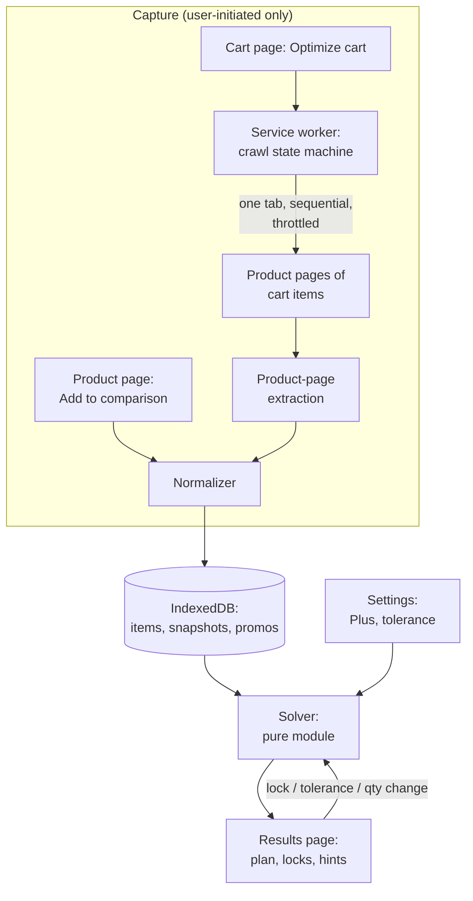

# 06 — Architecture

The architecture is shaped by the ground rules (README): advise-only, local-only, user-initiated capture, MV3 Chrome-first. Every component below exists because a decision in `00-decision-log.md` forces it — the mapping is stated per component so nothing here is decoration.

## Components

| # | Component | Responsibility | Forcing decisions |
|---|---|---|---|
| 1 | **Product-page content script** | Injects the "Add to comparison" button; extracts and normalizes the offer list for the selected variant | D-04, F-1 |
| 2 | **Cart-page content script** | Injects the "Optimize this cart" button; reads cart items + variants; triggers the crawl | D-04, F-10 |
| 3 | **Service worker (background)** | Owns the crawl state machine: opens/reuses one tab, navigates sequentially with delays, collects results, survives restarts, reports progress | D-03, D-04, NFR-07, R-08 |
| 4 | **Selectors module (versioned)** | The *only* code that touches DOM structure; versioned and fixture-tested | NFR-05, R-02 |
| 5 | **Normalizer** | Turns raw extractions into canonical entities (`08-data-model.md`) | FR-03 |
| 6 | **Storage** | IndexedDB for items / snapshot history / promos; `chrome.storage.local` for settings and crawl state | D-02, NTH-02 (history-first) |
| 7 | **Solver (pure module)** | The optimizer: input list in, plan + hints out; no I/O, no DOM, no state — runs identically in tests and production | D-15, NFR-09 |
| 8 | **Results page (extension page)** | Renders plan, locks, hints, settings; re-solves on input changes | FR-11–FR-14 |
| 9 | **Options page** | Defaults, language, tolerance, crawl delay, data export/clear | FR-14, FR-16, NFR-08 |

## Data flow

Two properties of this flow are load-bearing. First, **everything funnels through the normalizer into storage before anything is solved** — the solver never sees a DOM, so a site redesign breaks capture (visible, fixable) but never correctness of already-captured data. Second, **the solve path is a pure function of stored data plus settings**, which is what makes live re-solving on lock/tolerance changes free, and what makes the what-if simulator (NTH-05) nearly free later.

## The crawl, designed around etiquette and MV3 reality

The cart crawl (D-04) is the only place the extension navigates pages on the user's behalf, so it carries the strictest design constraints:

- **One tab, sequential navigation.** The crawl reuses a single tab and visits each cart item's product page in order, with a configurable inter-page delay (default 1.5s, NFR-07). No parallel tab storms — kinder to rate limits, easier to abort, easier to debug.
- **State lives in storage, not memory.** MV3 service workers are killed at will; the crawl state machine persists its cursor and per-item results after every step, so an interruption (browser restart, tab closed) resumes exactly where it stopped without duplicating work (R-08, FR-02).
- **User-visible and abortable.** Progress (item i of N, per-item status) renders in the results page; an abort control stops between navigations, never mid-page.
- **Per-item failure containment.** A page that fails extraction is recorded as a failure with its error class; the crawl continues; the results page shows the gap and offers a retry for that item. Partial results are always better than no results, and always honestly labeled.
- **Scope is closed.** The crawl may only visit product pages of items already in the user's cart or comparison list — the set is fixed at start, written to crawl state, and checked before every navigation.

## Permissions

`storage` (settings + data), `tabs` (crawl tab management), host permission for `*.digikala.com` only. No remote code, no web analytics, no `cookies`, no `history`. The store listing and privacy note must state: computation and data are local; the extension only reads pages the user is viewing or explicitly asks it to open. Any future permission request (e.g., for NTH-06 one-click apply) requires a decision-log entry first — that is deliberate friction.

## Technology choices (Phase 2 defaults)

TypeScript throughout; Vite + a Chrome-extension plugin for MV3 bundling; the solver as a dependency-free plain TS package (it must stay importable by unit tests with zero browser APIs); IndexedDB through a small typed wrapper (no ORM); no UI framework mandate — whatever renders the results page cleanly with RTL support (NFR-08). These defaults exist so tasks T02–T05 can start without re-litigating tooling; they are revisitable at T02 kickoff with a one-line decision-log note if the implementer disagrees.

## Failure containment summary

| Failure | Containment |
|---|---|
| Digikala DOM changes | Selectors module version bump; canary tests against saved DOM fixtures fail loudly (T06) |
| Service worker killed mid-crawl | Crawl state in storage; resume on next wake |
| Page extraction fails | Per-item error record; crawl continues; retry per item |
| Fee data missing/ambiguous | Offer stores "fee unknown"; plan shows the gap and the affected vendor group is labeled estimate-only |
| Cart exceeds scale envelope | Solver switches to labeled approximate mode (D-15, OQ-09) |
| Storage corruption / schema drift | Schema version field; migrations forward-only; export before migrate (FR-16) |
