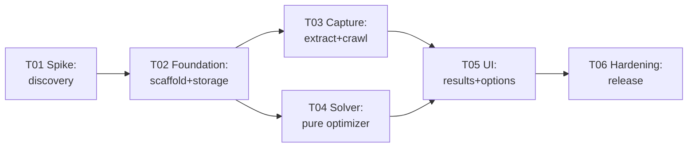

# Task Board

Tasks are split one file per task group — the SDD's "never dump everything into one file" rule applies to the backlog too. Each file carries its own goal, dependencies, task list with stable IDs, acceptance criteria, and definition of done.

## ID scheme and status

- Task group: `T0x` (this file's links). Individual task: `T0x.y` — cite these exact IDs in commits and PRs (`ref T04.3`).
- Status: `todo` / `in-progress` / `blocked` / `done` — tracked per group file; update them as you work, the files are the board.

## Dependency graph

T02 can start in parallel with T01 (scaffolding doesn't depend on spike answers), but **T03 and T04 designs freeze only after T01's go decision** — the spike's findings on fees, promos, and selectors are their inputs. T03 and T04 run in parallel from T02 onward; they touch no shared code beyond the data-model types.

## Estimates (solo dev, ideal days)

| Group | Scope | Estimate |
|---|---|---|
| T01 | Discovery spike | 2–3 |
| T02 | Foundation | 2 |
| T03 | Capture pipeline | 4–5 |
| T04 | Solver | 4–5 |
| T05 | UI surfaces | 4–5 |
| T06 | Hardening & release | 3 |
| **Total** | | **19–20 ideal days ≈ 4–5 weeks calendar** |

## General definition of done (applies to every group)

- All tests green; new behavior covered by tests named in the group file.
- No new network egress, no new permissions, no DOM access outside the selectors module (NFR-01/02/05/06).
- Docs updated: if implementation deviates from `06`–`09`, the doc changes in the same PR — the SDD stays true, it is not a historical artifact.
- Every requirement touched cites its FR/NFR ID in the PR description; every deviation cites the D-xx it amends.

## Adding tasks

New tasks get new IDs in their group file (never renumber existing ones); anything that grows beyond a group's scope becomes a new group file with an entry here, plus the reasoning in `00-decision-log.md` if it changes a decision.
